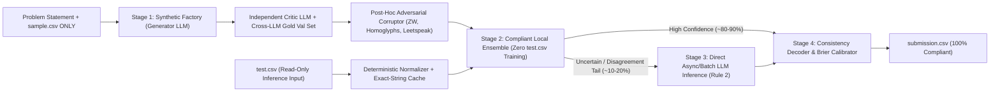

# NeuraHack 2026 Post-Mortem & Future Datathon Playbook

**Team:** `Turtlers` (Akib Hasan Pyil, K M Mubin, Abdullah Omar Faruk)  
**Event:** NSUCEC NeuraHack 2026 Preliminary Round (*ScamShield BD*)  
**Outcome:** `0.93661` Kaggle Public LB (`submission_v9_final.csv`) — **Did Not Qualify for Finals**  
**Purpose:** A no-excuses engineering post-mortem of why we missed finals, why our `98.299` CV did not match `0.93177` LB, how compliant `0.98–0.99+` pipelines actually work, and a battle-tested playbook for both **API-Allowed** and **Offline/Open-Weights-Only** datathons.

---

## Part 1 — Honest Post-Mortem: Why We Missed the Finals

### 1.1 The Rule-1 Compliance Failure
Near the end of the competition, the organizers issued an **Official Clarification on Permitted and Prohibited Use of Test Data**:

1. **Rule 1 — Pseudo-labeling using `test.csv`: PROHIBITED**  
   *Using test text for pseudo-labeling, self-training, label propagation, clustering-based labeling, or domain adaptation is prohibited.* ("The conditional wording in Section 14 of the PDF Rulebook should be interpreted accordingly.")
2. **Rule 2 — Direct LLM inference on test records: PERMITTED**  
   *Using pretrained LLMs to directly generate test predictions is permitted, provided inference is performed programmatically and the model/API usage is properly disclosed. The model must not be trained or adapted using test records.*
3. **Rule 3 — LLM-generated synthetic training data: PERMITTED**  
   *Generating synthetic training examples using LLMs is permitted, provided no test text or test predictions are used in the generation process. The process must be reproducible and properly disclosed.*

**What our `v7 -> v9` pipeline actually did:**
- [train_teachers_v4.py](preli/v2/train_teachers_v4.py) clustered `test.csv` into `285,810` structural skeletons and selected `45,000` test prototypes (`domain_pseudo_v4.npz`).
- [build_clean_pseudo_v5.py](preli/v2/build_clean_pseudo_v5.py) filtered those into **`39,618` pseudo-labeled `test.csv` rows** (`domain_pseudo_v5.npz`).
- [train_students_v4.py](preli/v2/train_students_v4.py), [train_da_bigru_v4.py](preli/v2/train_da_bigru_v4.py), and [train_da_tab_v4.py](preli/v2/train_da_tab_v4.py) **trained** our student models (`mMiniLM`, `mE5-small`, `BGE-small`, `BiGRU-v5`, `DA-Linear`, `DA-GBDT`) on `synth + sample + domain_pseudo_v5`.
- [final_package_turtlers/README.md](final_package_turtlers/README.md) openly disclosed `"Programmatic Unlabeled Domain Adaptation"` and `"pseudo-labeled programmatically"`.

**Lesson #1:** *Never assume conditional wording in an early PDF ("if permitted / if disclosed") stays safe under later clarifications. Treat `test.csv` as **read-only inference input** from Hour 0 unless pseudo-labeling is explicitly and unconditionally allowed.*

---

### 1.2 The `98.299` CV vs. `0.93177` LB Gap (The Hidden Validation Blind Spot)
A critical engineering lesson beyond Rule 1: our `v7` pipeline scored **`98.299` Composite on Scenario-Disjoint CV**, yet only **`0.93177` on Kaggle Public LB** (`-0.051` gap). Why?

1. **Grading Our Own Homework:** Validating on synthetic scenarios generated by *our own* `synth_generator_v4.py` (48 deterministic templates) meant even scenario-disjoint folds shared our generator's clean linguistic assumptions, hiding real-world `test.csv` phrasing complexity.
2. **86-Row Calibration Overfitting:** `sample.csv` had only `86` labeled rows (`~14` rows per class). Fitting `alpha` class multipliers and `tech_th` thresholds on 86 rows over-triggered `T1` (`85.1%` in `v7` vs `50.0%` in `sample.csv`) and skewed Class `1` `1.31x` over Class `0` — which we only caught in the last 25 minutes during `v8` (`+0.00375` LB).
3. **Rule-Over-Data Trap:** When synthetic data lacks natural Banglish pragmatics, teams end up writing manual regex patches (`v8`/`v9`) in the final hour instead of fixing data/model generalization earlier.

---

### 1.3 Why `0.93661` vs. `~0.99`
| Dimension | What We Built (`0.93661`) | What `~0.99` Compliant Pipelines Do |
|---|---|---|
| **Training Data (`86` samples)** | 48 programmatic Python templates (`synth_generator_v4.py`) + prohibited `test.csv` pseudo-labels | Frontier LLM-authored synthetic conversations (Rule 3) with massive linguistic, pragmatic, and multi-turn diversity |
| **Validation** | `sample.csv` (86 rows) + same-generator synthetic OOD (`98.299` vs `0.93177` LB gap) | Cross-LLM independent Gold Validation set + distribution/base-rate sanity checks |
| **Hard Edge-Case Reasoning** | Local 4 GB VRAM `mMiniLM` / `mDeBERTa-v3-base` / `BiGRU` + late regex fixes | Direct LLM API inference (Rule 2) on ambiguous/hard rows with the full rubric in context |
| **Test-Data Training** | Violated Rule 1 via `39,618` test prototypes | **Zero** training, clustering-based labeling, or adaptation on `test.csv` |

---

### 1.4 What We Got Right (Reusable Engineering Assets)
1. **Adversarial Text Normalization ([normalizer_v4.py](preli/v2/normalizer_v4.py)):** Un-defanging `hxxp`/`[.]`, stripping zero-width chars (`54,310` rows) & Cyrillic homoglyphs (`42,538` rows), masking raw domains (`<URL_SUSP>`/`<URL>`) to block domain-token shortcuts, and isolating `<EMOJI_*>` tokens.
2. **Leak-Free CV Mechanics ([cv_ood.py](preli/v2/cv_ood.py)):** Scenario-disjoint GroupKFold & LOSO splitting so template skeletons never cross train/val boundaries.
3. **Head-Conditioned Multi-Task Architecture ([torch_utils_v4.py](preli/v2/torch_utils_v4.py)):** Conditioning Task B (`techniques`) and Task C (`action`) heads on detached Task A probabilities + `LayerNorm(feats_58)`.
4. **Submission Integrity & Packaging ([verify_submission.py](preli/verify_submission.py), [build_final_package.py](preli/v2/build_final_package.py)):** Automated schema/invariant checks and clean-room `nbconvert` verification.

---

## Part 2 — Two-Mode Architecture for Future Datathons

Before writing code in Hour 0, check the rulebook for **which mode applies**:
- **Mode A (External LLM APIs Permitted — like NeuraHack 2026 Rules 2 & 3):** Use the 4-Stage LLM-Hybrid pipeline below.
- **Mode B (Offline / Open-Weights Only — standard Kaggle/strict datathons):** Skip API stages; use local open-weight LLMs (e.g., 7B–14B quantized GGUF/AWQ/vLLM) for Rule-3 synthetic generation and/or slow local inference on the uncertain tail.

---

### Stage 1: Cross-Validated Synthetic Data Factory (Rule 3 Compliant)
**Strict Rule:** *Never feed `test.csv` rows or `test.csv`-derived rules into generation prompts.*

1. **Combinatorial Coverage Matrix (Derived Only from Problem Statement + `sample.csv`):**
   - Cross `Label (0..5)` × `Techniques (T1..T6)` × `Action (0..5)` × `Language (English, Bangla, Banglish, Code-Switched)` × `Channel` × `Turns (1..12)`.
   - Explicitly oversample **hard negatives** (legitimate OTP warnings, real courier retries, automated `"do not reply"` footers) and **priority collisions** (bait-and-switch multi-turn threads that start as job/parcel hooks and end with OTP/PIN/AnyDesk theft).
2. **Avoid Grading Your Own Homework (Generator != Validator):**
   - Generate training examples with **Model Family A** (e.g., Gemini / GPT) and generate an independent **Gold Validation Set** with **Model Family B** (e.g., Claude) + `sample.csv`, plus a critic pass that verifies every `(label, techniques, action)` tuple against the exact Section 4 rubric.
3. **Post-Hoc Adversarial Corruption:**
   - Apply zero-width chars, homoglyphs, leetspeak (`0/7/3/4`), missing spaces, and character floods **programmatically after generation**, so ground-truth labels remain 100% exact while models learn adversarial robustness.

---

### Stage 2: Compliant Local Multi-Family Ensemble (Zero `test.csv` Leakage)
Train strictly on `sample.csv + Stage-1 synthetic`:
1. **Leak-Free Preprocessing:** Fit `TfidfVectorizer`, `TruncatedSVD`, `StandardScaler`, tokenizers, and calibration scalers **strictly on training folds** — never on `test.csv`.
2. **Diverse Families:** Lexical (`TF-IDF Linear`), Tabular (`LightGBM + XGBoost + CatBoost`), and Multilingual Transformers (`mDeBERTa-v3-base`, `XLM-RoBERTa`, `BGE-M3`).
3. **Base-Rate & Calibration Guardrails:** Compare predicted class/technique/action marginals on validation against `sample.csv` and domain expectations; never tune `alpha` multipliers aggressively on `< 200` samples.

---

### Stage 3: Direct LLM API Inference — Real-World Cost, Latency & Calibration (Rule 2 Compliant)

1. **Exact-String Inference Caching (Never Clustering-Based Propagation):**
   - Deterministically strip whitespace/invisible noise; if multiple test rows produce the **exact same normalized string**, call the API **once** for that exact string and reuse the prediction for identical duplicates.
   - *Compliance boundary:* Never propagate labels across *different* messages via embedding similarity/clustering, and never retrain any model on API outputs.
2. **Confidence-Gated Hybrid Routing:**
   - Run the fast local ensemble on all `500k` rows (`~15–30 min` locally).
   - Route the high-confidence `80–90%` directly to output; escalate only the **lowest-margin / highest-disagreement `10–20%` (`50k–100k` rows)** to the LLM API (with optional 2nd-tier escalation of the hardest `1–2%` to a stronger reasoning model).
3. **24-Hour Datathon Latency Trap — Async Concurrency vs. Batch API:**
   - **Critical Warning:** Commercial **Batch APIs** (OpenAI/Anthropic/Google) give a 50% cost discount, **but their SLA is up to 24 hours**. In a 24-hour hackathon, submitting a Batch API job at Hour 18 can miss the deadline!
   - **Production solution for 24h events:** Use **async concurrent real-time APIs** (`asyncio` + `aiohttp`/SDK + semaphore + exponential backoff + append-only JSONL checkpointing by row ID) on fast models (`gpt-4o-mini`, `gemini-2.5-flash`, `deepseek-chat`), OR start Batch API jobs **early (Hour 10–14)** only if you have tested turnaround time.
4. **Realistic Token & Cost Math (Example: `50k` Escalated Rows):**
   - Single-row calls: `50k` × (`~800` cached system + `~150` user + `~60` JSON output) = `40M` cached input + `7.5M` uncached input + `3M` output tokens. On fast-tier models with prompt caching, that is roughly **\$2–\$8**; on frontier-tier models (`gpt-4o`/`claude-sonnet`), **\$50–\$100+**.
   - **Batch-packing optimization:** Packing `5–10` rows per prompt (`[{"id": ..., "text": ...}]`) cuts system-prompt and JSON wrapper overhead by **5–8×**, though keep pack size `<= 10` on complex multi-label rubrics to avoid attention degradation.
5. **Brier-Calibrated Confidence Without Assuming `logprobs`:**
   - Do **not** hardcode `0.99` on LLM predictions (one miss at `0.99` costs `0.98` squared error in Brier!).
   - Where `logprobs` are supported (e.g., OpenAI `gpt-4o`/`gpt-4o-mini`), compute calibrated probability from top-k class token logprobs.
   - Where `logprobs` are **not** available (e.g., Claude, or some JSON-schema endpoints), calibrate confidence using **ensemble-LLM agreement + self-consistency (2-pass temperature sampling on borderline rows)** + temperature scaling fitted on the Gold Validation Set.

---

### Stage 4: Safe EDA vs. Prohibited Test-Data Leakage
| Activity on `test.csv` | Safe / Compliant? | Why |
|---|---|---|
| Checking schema, row count, null rates, char encodings (`\u200b`, Cyrillic, Bangla, `|||`) | **Yes (Safe EDA)** | Pure data-format/preprocessing hygiene; does not adapt models or leak labels. |
| Exact-string deduplication at inference time | **Yes (Inference Optimization)** | Identical input produces identical deterministic output. |
| Selecting test prototypes / clustering to pseudo-label & train students | **NO (Rule 1 Violation)** | Prohibited pseudo-labeling / clustering-based labeling / domain adaptation. |
| Fitting `TfidfVectorizer` / `SVD` / `StandardScaler` / thresholds on `test.csv` | **NO (Leakage / Adaptation)** | Adapts feature space or decision boundaries to test distribution. |
| Hand-crafting label rules by reading `test.csv` error rows | **Risky / Avoid** | Leaks test patterns into model logic and risks overfitting Public LB; derive rules from Problem Statement + Gold Val instead. |

---

## Part 3 — Reusable Hour-by-Hour Checklist

### Hour 0–1: Rules, Metric & Budget Audit
- [ ] Read **all** rules & clarifications: Are external APIs allowed for (a) synthetic data, (b) test inference? Is pseudo-labeling / domain adaptation on `test.csv` banned?
- [ ] Implement the **exact** evaluation metric (including Brier/calibration terms) + submission validator before training.
- [ ] Run safe format EDA on `test.csv` (nulls, encodings, max turns, duplicate rate) and compute API token/latency budget if Rule 2 applies.

### Hour 1–4: Clean Foundation
- [ ] Build deterministic adversarial normalization (invisible chars, homoglyphs, URL masking, turn markers).
- [ ] Build **leak-free GroupKFold / Scenario-Disjoint CV** + independent **Gold Validation Set** (if using synthetic data, generate Val with a different model/prompt than Train).
- [ ] Ship a 100% compliant baseline submission end-to-end.

### Hour 4–16: Synthetic Factory & Diverse Local Models
- [ ] Generate diverse synthetic training data (Rule-3 LLM factory in Mode A, or open-weight local LLM + rich templates in Mode B) + post-hoc adversarial corruptions.
- [ ] Train 3+ genuinely diverse local families (`TF-IDF Linear`, `GBDT`, `Transformer`) **strictly without `test.csv`**.
- [ ] Verify CV-to-LB alignment early (if CV is `0.98` and LB is `0.93`, fix the validation gap immediately — do not ignore it).

### Hour 16–22: Hybrid Inference, Calibration & Stress Testing
- [ ] If Mode A applies: run **async checkpointed LLM inference** on the uncertain/disagreement slice (watch Batch API 24h SLA!).
- [ ] Fit temperature scaling / Brier calibration on Gold Val (never tune aggressive multipliers on `< 200` rows).
- [ ] Run automated adversarial unit tests (leetspeak, footers, priority collisions) continuously.

### Hour 22–24: Final Compliance & Packaging Audit
- [ ] **Zero-Leakage Code Audit:** `grep` every training/feature-fitting script to confirm `test.csv` is **never** read during `fit`, vocabulary building, clustering, or threshold tuning.
- [ ] **Disclosure Audit:** Confirm every open-weight model, API, synthetic pipeline, and seed is accurately disclosed in `README.md` with zero Rule-1 violations.
- [ ] **Clean-Room Execution:** Re-run `notebook.ipynb` via `nbconvert` and verify final `submission.csv` checksums, row counts, and invariants.
