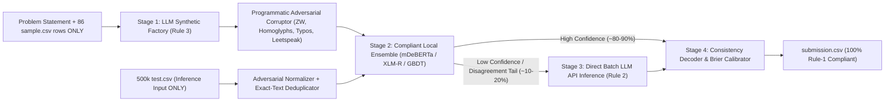

# NeuraHack 2026 Post-Mortem & Future Datathon Playbook

**Team:** `Turtlers` (Akib Hasan Pyil, K M Mubin, Abdullah Omar Faruk)  
**Event:** NSUCEC NeuraHack 2026 Preliminary Round (*ScamShield BD*)  
**Outcome:** `0.93661` Kaggle Public LB (`submission_v9_final.csv`) — **Did Not Qualify for Finals**  
**Purpose:** An honest engineering post-mortem of what went wrong, a technical breakdown of how compliant `0.98–0.99+` LLM-hybrid pipelines work under the competition rules, and a reusable playbook for future datathons.

---

## Part 1 — Honest Post-Mortem: Why We Missed the Finals

### 1.1 The Compliance Violation (Rule 1)
Near the end of the competition, the organizers issued an **Official Clarification on Permitted and Prohibited Use of Test Data**:

1. **Rule 1 — Pseudo-labeling using `test.csv`: PROHIBITED**  
   *Using test text for pseudo-labeling, self-training, label propagation, clustering-based labeling, or domain adaptation is prohibited.* ("The conditional wording in Section 14 of the PDF Rulebook should be interpreted accordingly.")
2. **Rule 2 — Direct LLM inference on test records: PERMITTED**  
   *Using pretrained LLMs to directly generate test predictions is permitted, provided inference is performed programmatically and the model/API usage is properly disclosed. The model must not be trained or adapted using test records.*
3. **Rule 3 — LLM-generated synthetic training data: PERMITTED**  
   *Generating synthetic training examples using LLMs is permitted, provided no test text or test predictions are used in the generation process. The process must be reproducible and properly disclosed.*

**What our `v7 -> v9` pipeline actually did:**
- [train_teachers_v4.py](preli/v2/train_teachers_v4.py) clustered `test.csv` into `285,810` structural skeletons and selected `45,000` test prototypes (`domain_pseudo_v4.npz`).
- [build_clean_pseudo_v5.py](preli/v2/build_clean_pseudo_v5.py) filtered those into **`39,618` pseudo-labeled `test.csv` rows** (`domain_pseudo_v5.npz`).
- [train_students_v4.py](preli/v2/train_students_v4.py), [train_da_bigru_v4.py](preli/v2/train_da_bigru_v4.py), and [train_da_tab_v4.py](preli/v2/train_da_tab_v4.py) **trained** our student models (`mMiniLM`, `mE5-small`, `BGE-small`, `BiGRU-v5`, `DA-Linear`, `DA-GBDT`) on `synth + sample + domain_pseudo_v5`.
- [final_package_turtlers/README.md](final_package_turtlers/README.md) openly disclosed `"Programmatic Unlabeled Domain Adaptation"` and `"pseudo-labeled programmatically"`.

**Lesson #1:** *Never assume conditional wording in an early PDF ("if permitted / if disclosed") stays safe under later clarifications, and never rely on `test.csv` pseudo-labeling or domain adaptation when Rule 3 (synthetic data) and Rule 2 (direct inference) are available.*

---

### 1.2 Why `0.93661` vs. `~0.99` (The Technical Ceiling We Hit)
Even setting compliance aside, our `0.93661` pipeline had a structural accuracy ceiling compared to frontier LLM-hybrid pipelines:

| Dimension | What We Built (`0.93661`) | What `~0.99` Compliant Pipelines Do |
|---|---|---|
| **Training Data (`86` samples)** | Programmatic template generator (`synth_generator_v4.py`, 48 fixed scenario templates) + prohibited `test.csv` pseudo-labels | Frontier LLM-authored synthetic conversations (Rule 3) with massive linguistic, pragmatic, and multi-turn diversity |
| **Hard Edge-Case Reasoning** | Local 4 GB VRAM `mMiniLM` / `mDeBERTa-v3-base` / `BiGRU` + regex rules (`rules_v4` / `v8` / `v9`) | Direct Frontier/Fast LLM API inference (Rule 2) on ambiguous/hard rows with the full rubric in context |
| **Adversarial & Banglish Pragmatics** | Manual regex patches discovered in the last 25 minutes (`don07 share`, `select hoyechen`, `clearance charge`) | Frontier LLMs natively understand noisy Banglish, sarcasm, indirect threats, and priority collisions zero-shot |
| **Test-Data Training** | Violated Rule 1 via `39,618` test prototypes | **Zero** training or adaptation on `test.csv` |

---

### 1.3 What We Got Right (Keep These Forever)
Not everything was a mistake — several engineering choices in this repo were genuinely strong and worth reusing:
1. **Adversarial Normalization ([normalizer_v4.py](preli/v2/normalizer_v4.py)):** Un-defanging `hxxp`/`[.]`, stripping zero-width chars (`54,310` test rows) and Cyrillic homoglyphs (`42,538` test rows), masking raw domains (`<URL_SUSP>`/`<URL>`) to prevent shortcut memorization, and isolating `<EMOJI_*>` tokens.
2. **Scenario-Disjoint Leak-Free CV ([cv_ood.py](preli/v2/cv_ood.py)):** Grouping folds by `scenario_family` + LOSO so train and validation never share template skeletons.
3. **Head-Conditioned Multi-Task Architecture ([torch_utils_v4.py](preli/v2/torch_utils_v4.py)):** Feeding detached Task A (`label`) probabilities + `LayerNorm(feats_58)` into Task B (`techniques`) and Task C (`action`) heads, enforcing joint consistency.
4. **Metric-Aware Calibration:** Optimizing separate per-task blend weights and Brier-calibrated confidences instead of argmax-only tuning.
5. **Clean Packaging & Reproducibility ([build_final_package.py](preli/v2/build_final_package.py)):** Isolated `nbconvert` verification, deterministic seeds, and exact submission schema assertions ([verify_submission.py](preli/verify_submission.py)).

---

## Part 2 — Technical Deep-Dive: How Compliant `0.98–0.99+` LLM-Hybrid Pipelines Work

When a competition gives tiny labeled data (`86` rows), massive unlabeled test data (`500,000` rows), and **allows external LLM APIs for synthetic generation (Rule 3) and direct test inference (Rule 2)**, the optimal architecture has four decoupled stages:

### Stage 1: Frontier LLM Synthetic Data Factory (Rule 3 Compliant)
**Core principle:** *Never touch `test.csv` while designing prompts or generating training data.*

1. **Persona & Scenario Matrix Generation:**
   - Instead of writing 48 static Python f-string templates, define a structured combinatorial grid from the **Problem Statement**:
     - `Label (0..5)` × `Techniques (T1..T6 subsets)` × `Action (0..5)` × `Channel (SMS, WhatsApp, Messenger, Email)` × `Language (English, Bangla script, Banglish, mixed code-switching)` × `Thread length (1..12 turns)`.
   - Include explicit **hard-negative cells**:
     - Benign bank alerts (`"do not share OTP"`, `"someone tried to log in"`)
     - Legitimate courier/delivery retries (`096...` customer care, no fee/credential trap)
     - Benign footer disclaimers (`"Please do not reply to this automated message"`)
     - Multi-turn **priority-collision** conversations (e.g., starts as a parcel/job hook, escalates to OTP/PIN theft → must be Priority `1` or `2`, not `4` or `3`).
2. **Prompting & Structured Generation:**
   - Use a frontier LLM (`GPT-4o`, `Claude`, `Gemini Pro/Flash`) with **JSON Schema Structured Outputs** to emit `(text, label, techniques, action, rationale)`.
   - Sample 3–5 examples from `sample.csv` matching the target class as style/format anchors.
3. **LLM-as-Critic Verification + Adversarial Augmentation:**
   - Pass generated samples through a second verification prompt checking strict compliance with the Section 4 priority order (`1 > 2 > 4 > 3 > 5 > 0`) and action/technique invariants; discard inconsistent generations.
   - Apply **programmatic adversarial corruption** *after* clean generation (zero-width characters, Cyrillic/Greek homoglyphs, leetspeak, dropped spaces, doubled characters) so labels stay 100% exact while models learn to survive noisy test inputs.

---

### Stage 2: Compliant Local Multi-Family Ensemble (Zero `test.csv` Training)
Train diverse local models **exclusively** on `sample.csv + Rule-3 LLM-synthetic data`:

1. **Text Normalization + Feature Engineering:**
   - Apply identical deterministic normalization at train and inference time (homoglyph folding, URL domain masking, turn markers `[T1] ... [T2]`, structural counters).
2. **Diverse Inductive Backbones:**
   - **Lexical/Tabular:** Word + Char TF-IDF `LogisticRegression` and `LightGBM / XGBoost / CatBoost`.
   - **Sequence/Transformer:** `mDeBERTa-v3-base` / `XLM-RoBERTa` / `BGE-M3` with multi-task head conditioning and class-balanced focal/BCE losses.
3. **Leak-Free Validation:**
   - Validate via **GroupKFold / Scenario-Disjoint CV** on `sample.csv` + held-out synthetic scenario families.
   - **Crucial:** Measure both **Composite Metric** (`0.40 F_A + 0.15 F_B + 0.10 F_C + ...`) and **Calibration (Brier score)** on out-of-distribution folds.

---

### Stage 3: Direct Batch LLM API Inference & Cost Engineering (Rule 2 Compliant)
Calling a frontier API naively on `500,000` rows is expensive and slow. Compliant top teams solve this cleanly at **inference time**:

1. **Exact / Normalized Inference Caching (Not Clustering-Based Labeling):**
   - Clean whitespace/invisible zero-width noise deterministically; if `N` test rows map to the exact same normalized string, call the API **once** for that exact string and return the cached prediction for identical copies.
   - *Rule check:* Never use nearest-neighbor / embedding clustering to propagate labels to *different* messages, and never retrain any model on the API outputs.
2. **Confidence-Gated Hybrid Routing (Selective Escalation):**
   - Run the fast local ensemble (Stage 2) on all `500,000` rows.
   - Partition test rows by **ensemble margin + cross-model disagreement**:
     - **High-Confidence Slice (~80–90%):** Local ensemble already agrees strongly (`margin > threshold`, `entropy < threshold`). Keep local predictions.
     - **Uncertain / Contested Slice (~10–20%, e.g. `50k–100k` unique rows):** Route directly to a fast, low-cost Batch LLM API (`gemini-2.5-flash`, `gpt-4o-mini`, `deepseek-chat`).
     - *(Optional 2nd tier)*: Route the top `1–2%` (`5k–10k`) most ambiguous/highest-disagreement rows to a frontier reasoning model (`gpt-4o` / `claude-sonnet` / `gemini-pro`).
3. **Rubric-Embedded System Prompt + Structured Outputs:**
   - Put the **entire labeling guide** in the cached system prompt:
     - Exact category definitions (`0..5`) and strict priority tie-breaker (`1 > 2 > 4 > 3 > 5 > 0`).
     - Exact `T1..T6` definitions and `action (0..5)` definitions.
     - Known boundary rules (e.g., `"clearance charge"` inside a job/reward scam still follows higher-priority/origin rules; `"do not reply"` footer does not negate a scam body; `"don't share OTP"` without credential harvesting = legitimate warning `0`).
     - 8–12 carefully chosen boundary examples from `sample.csv`.
   - Use **Prompt Caching** (90% input token discount on repeated system prompts) + **Batch API** (50% async discount) so `50k–100k` short SMS/chat classifications cost only a few dollars and finish in minutes.
4. **Calibrating LLM Confidence for Brier Score (`0.10 F_F` / `0.05 C`):**
   - Never hardcode `confidence = 0.99` on LLM outputs.
   - Extract **token logprobs** (probability of the predicted class token) or blend the LLM's structured confidence with the local ensemble's probability, then apply **temperature scaling** fitted strictly on OOD validation (`sample.csv` + held-out synthetic).

---

### Stage 4: Deterministic Priority Invariants & Error Auditing
1. **Strict Schema & Logical Invariants:**
   - Enforce `action = 0` and `techniques = NONE` iff `label in {0, 5}`.
   - Enforce valid `confidence` bounds `(0, 1]` and exact row alignment.
2. **Automated Adversarial Stress Suite (Built Before Final Hours):**
   - Maintain a unit test suite of synthetic/hand-written adversarial traps (`leetspeak OTP`, `zero-width splits`, `multi-turn bait-and-switch`, `benign disclaimers`) and verify every pipeline change against it continuously — not in the last 25 minutes.

---

## Part 3 — Reusable Checklist for Future Datathons

### Hour 0–1: Rules & Metric Audit
- [ ] Read **every** rulebook section + organizer announcements/clarifications on:
  - External APIs (allowed for synthetic data? allowed for test inference? allowed at all?)
  - Unlabeled test data (is pseudo-labeling / clustering / domain adaptation **explicitly banned**?)
  - Pretrained open-weight models & external datasets
- [ ] Implement the **exact** competition evaluation metric (including calibration/Brier/threshold terms) before training any model.

### Hour 1–4: Clean Foundation
- [ ] Build adversarial text normalization (invisible chars, homoglyphs, URL masking, turn formatting).
- [ ] Build **leak-free GroupKFold / Scenario-Disjoint CV** (zero shared templates between train and val).
- [ ] Ship an end-to-end compliant baseline submission + submission validator script.

### Hour 4–16: Data & Diverse Models
- [ ] If LLM synthetic data is permitted: build a **Stage-1 LLM Synthetic Factory** with critic filtering + post-hoc adversarial corruption.
- [ ] Train 3+ genuinely diverse local families (`TF-IDF Linear`, `GBDT`, `Transformer`) **strictly without `test.csv`**.

### Hour 16–22: Hybrid Inference & Calibration
- [ ] If direct LLM inference is permitted: calculate Batch API cost/rate budget on normalized unique inputs and escalate the **uncertain/disagreement slice** directly to a rubric-prompted LLM.
- [ ] Optimize per-task thresholds and temperature-scaled Brier confidence on OOD CV.

### Hour 22–24: Final Compliance & Packaging Audit
- [ ] **Zero-Leakage Audit:** Verify `test.csv` is **never** read inside any training, feature-selection, tokenizer-fitting, TF-IDF-fitting, or clustering-for-labels script.
- [ ] **Disclosure Audit:** Verify every model, API, seed, and synthetic pipeline in `README.md` matches the exact competition rules.
- [ ] **Clean-Room Execution:** Re-run `notebook.ipynb` via `nbconvert` and validate final `submission.csv` checksums and row counts.
