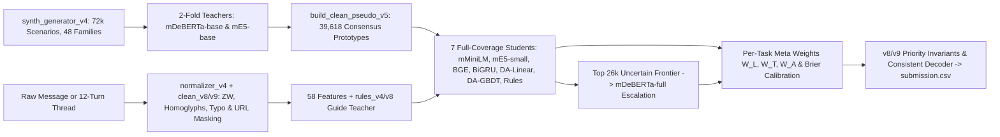

# NSUCEC NeuraHack 2026 — Team `Turtlers`

**From a 300-row transit feedback prototype (`0.9833` LOO Macro-F1) to a 500,000-row multilingual adversarial scam defense system (`0.93661` Public LB) in 30 hours on a single 4 GB VRAM laptop GPU.**

**Team `Turtlers`:** Akib Hasan Pyil · K M Mubin · Abdullah Omar Faruk

> **Quick Links for Viewers & Reviewers:**
> - **Post-Mortem & Future Datathon Playbook (Lessons Learned + `0.99`-Tier Architecture):** [POSTMORTEM_AND_PLAYBOOK.md](POSTMORTEM_AND_PLAYBOOK.md)
> - **Interactive Self-Contained Notebook (with Live Outputs):** [final_package_turtlers/notebook.ipynb](final_package_turtlers/notebook.ipynb)
> - **Technical Verification & Resource Declarations:** [final_package_turtlers/README.md](final_package_turtlers/README.md)
> - **Final Production Pipeline (`v2` + `v8/v9` Hotfixes):** [preli/v2/](preli/v2/)

---

## Leaderboard & Validation Scoreboard

### Main Preliminary Round — *ScamShield BD* (`500,000` test records, `24` hours)
| Milestone | Architecture / Breakthrough | OOD Proxy (`Composite`) | Kaggle Public LB |
|---|---|---|---|
| **Baseline Sprint (`v1`)** | Initial multi-encoder + tabular stack ([preli/v1/](preli/v1/)) | `—` | `0.85118` |
| **Hardening (`v4`)** | URL-domain masking + non-colliding emoji normalization (`sub_v6_fast.csv`) | `—` | `0.88933` |
| **Leak-Free Audit (`v5`)** | Guide priority fixes + 72k synth + TF-IDF Linear + LGBM/XGB/CatBoost (`sub_v6b_v5.csv`) | `91.080` (`F_A 97.17`) | `0.93011` (`+0.04078`) |
| **8-Family Stack (`v7`)** | Consensus 39.6k distillation (`mMiniLM`, `mE5-small`, glossed `BGE`, `BiGRU-v5`, `DA-Tab`) + `26k` `mDeBERTa-full` escalation | **`98.299`** (`F_A 100.0`, `F_C 100.0`) | `0.93177` |
| **Adversarial Hotfix (`v8`)** | Fixed `"do not reply"` & `"clearance charge"` bugs, removed 86-row `T1`/`alpha` overfit, GPU re-scored `28k` repaired rows | `98.225` (`rules_v8` on `sample.csv`) | `0.93552` (`+0.00375`) |
| **Final Selection (`v9`)** | Zero-FP obfuscated Priority-1 & double-article reward/job priority patch (`submission_v9_final.csv`) | `99.393` inductive smoke check | **`0.93661`** (`+0.08543` total) |

### Mock Preliminary Round — *TransitText* (`300` test records, `~6` hours)
| Milestone | Method | `sample.csv` Validation |
|---|---|---|
| Raw Baseline | Raw TF-IDF + `LogisticRegression` | `0.2333` LOO / `0.3333` 10-Fold |
| Normalized Encoder | Text denoising + Banglish normalization ([text_clean.py](experiments/text_clean.py)) + `BAAI/bge-m3` | `0.9167` LOO / `0.9172` Macro-F1 |
| LLM Few-Shot | `Qwen/Qwen2.5-1.5B-Instruct` KV-cached logit classifier ([step5c_qwen_kvcached.py](experiments/step5c_qwen_kvcached.py)) | `0.9667` 24-shot LOO |
| Final Mock Ensemble | Synthetic Rule-5 augmentation + Stage-2 self-training ensemble ([step9b_synth_and_ensemble.py](experiments/step9b_synth_and_ensemble.py)) | **`0.9833` LOO Macro-F1** |

---

## The Story Behind Our 30 Hours

### Chapter 1 — Warm-Up in Mock Prelims ([mock/](mock/), [experiments/](experiments/))
Before the main event began, the Mock Preliminary round (*TransitText*) taught us our first core lesson about Bangladeshi NLP datasets: raw off-the-shelf models crumble (`0.2333` LOO) when English, Bangla script, and Banglish share threads wrapped in noisy templates — until clean normalization, semantic transliteration glossing, and targeted synthetic examples lifted us to **`0.9833` LOO Macro-F1**. That rapid iteration loop became our playbook for the main 24-hour sprint.

### Chapter 2 — Hour 0–8: The Scale Shock & `0.85118` Plateau ([preli/v1/](preli/v1/))
The Main Preliminary round (*ScamShield BD*) escalated the challenge by three orders of magnitude:
- **`500,000` test records** (`285,810` unique structural skeletons) with **only `86` labeled training examples** in `sample.csv`.
- **4 coupled tasks** scored by a strict Section 10 composite (`0.40 F_A + 0.15 F_B + 0.10 F_C + 0.10 F_D + 0.10 F_E + 0.05 C + 0.10 F_F`) with category priority **`1 > 2 > 4 > 3 > 5 > 0`** and strict consistency (`action=0` and `techniques=NONE` iff `label in {0, 5}`).
- **Severe linguistic & adversarial variety in `test.csv`**: `107,248` multi-turn `|||` threads (up to 12 exchanges), `54,837` Bangla-script rows, `54,310` zero-width obfuscated rows (`\u200b` etc.), and `42,538` Cyrillic/Greek homoglyph attacks — all while training on a **single 4 GB VRAM NVIDIA GTX 1650 laptop (`8.24 GB` system RAM)**.

Our initial Phase-1 sprint ([preli/v1/](preli/v1/)) stacked early synthetic generators and fast encoders up to **`0.85118`** on Kaggle — solid, but nowhere near the `0.93+` tier.

### Chapter 3 — Hour 8–14: Forensics, Leak-Free CV & The `+0.07893` Leap ([preli/claude/](preli/claude/), [preli/v2/](preli/v2/))
Comparing our `0.85118` errors against the Problem Statement and structural template clusters ([preli/claude/claude.txt](preli/claude/claude.txt)) revealed two root bugs:
1. Our models were memorizing raw domain strings in URLs and overfitting on random splits that leaked near-identical synthetic templates across train/val folds.
2. Specific real-world Bangladeshi test patterns were mislabeled systematically (`Pathao Pay` rewards links confused with payment actions, courier `096` retry notices flagged as parcel phishing, PM scholarship/allowance arrears vs job scams, and `"do not tell anyone about this"` secrecy decoys inside credential traps).

We engineered a clean ground-up **`v2` architecture**:
- **[normalizer_v4.py](preli/v2/normalizer_v4.py)**: Un-defangs `hxxps://` and `[.]`, strips zero-width & Cyrillic confusables, isolates semantic `<EMOJI_*>` tags (fixing false `PRIZE` matches on gift emojis), masks untrusted URL domains (`<URL_SUSP>/<URL>`) to prevent shortcut learning, formats turn order (`format_turn_aware`), and generates English semantic glosses (`bn_to_en_roman_v4`).
- **[rules_v4.py](preli/v2/rules_v4.py) & [cv_ood.py](preli/v2/cv_ood.py)**: Enforces strict Section 4 priority (`1 > 2 > 4 > 3 > 5 > 0`), extracts `58` domain features (`24` structural + `34` policy indicators), and introduces **Scenario-Disjoint Balanced 3-Fold CV (`get_balanced_3folds`) & LOSO exclusions** so train and validation never share scenarios. Untuned `rules_v4` scored `99.458` Composite on `sample.csv`.
- **[synth_generator_v4.py](preli/v2/synth_generator_v4.py)**: Generates `72,000` diverse single/multi-turn conversations across `48` distinct scenario families (`corrupt_prob=0.68`, `seed=4242`).

Fixing URL masking alone jumped LB **`0.85118 -> 0.88933`**, and the full `v5` rule + `TF-IDF Linear + LightGBM + XGBoost + CatBoost` pipeline (`sub_v6b_v5.csv`) leaped **`+0.04078` to `0.93011`**.

### Chapter 4 — Hour 14–23: Surviving 4 GB VRAM & Multi-Task Knowledge Distillation
Attempting to run a 1.5B FP16 LLM teacher hit WDDM PCIe swapping (`0.36 rows/s`), which would have blown past the 24-hour clock. Instead of brute-forcing oversized weights, we engineered a lean distillation stack tuned for 4 GB VRAM (`<= 2.7–3.3 GB` peak):
1. **2-Fold Base Teachers ([train_teachers_v4.py](preli/v2/train_teachers_v4.py))**: `mDeBERTa-v3-base` (`freeze=5`, `bs=8`, grad-accum) and `mE5-base` scored `45,000` canonical cluster prototypes in unlabeled `test.csv`.
2. **Consensus Filtering ([build_clean_pseudo_v5.py](preli/v2/build_clean_pseudo_v5.py))**: Retained **`39,618 / 45,000` (`88.0%`, `mean_conf=0.8201`)** prototypes where teachers, rules, and tabular baselines agreed cleanly — eliminating half-fold teacher blind spots and secrecy decoys.
3. **7 Diverse Full-Coverage Families + Selective Escalation ([train_students_v4.py](preli/v2/train_students_v4.py), [train_da_bigru_v4.py](preli/v2/train_da_bigru_v4.py), [train_da_tab_v4.py](preli/v2/train_da_tab_v4.py))**:
   - `HeadConditionedTransformer`: Task B (`techniques`) and Task C (`action`) heads condition explicitly on detached Task A probabilities + `LayerNorm(feats_58)`.
   - Trained `mMiniLMv2-L6-mnli-xnli`, `multilingual-e5-small`, glossed `bge-small-en-v1.5`, 2-layer `BPEBiGRUNet` (`BiGRU-v5`), `DA-Linear`, and `DA-GBDT (LGBM + XGB + CatBoost)`.
   - Trained full-scenario `mDeBERTa-full` and applied **selective inductive escalation** on the `26,000` highest-uncertainty / cross-model disagreement rows ([predict_inductive_v4.py](preli/v2/predict_inductive_v4.py)).

On strictly scenario-disjoint OOD validation (`sample_v4`), Transformers & BiGRU lifted Task B (`+6` to `+12` F1) and Task C (`+13` to `+18` F1) over GBDT alone, lifting our stacked zero-leakage proxy score from `91.080` to **`98.299`** (`0.93177` LB).

### Chapter 5 — The Final 25-Minute Forensic Breakthrough (`0.93177 -> 0.93552 -> 0.93661`)
Seeing `v7` (`0.93177`) barely beat tabular `v5` (`0.93011`) with only 23 minutes left before deadline forced us to look directly at the `500,000` predictions instead of trusting OOF alone — uncovering four exact adversarial failure modes shared across all 7 models:
1. **Benign-wrapper hijack**: `NEG_WARN_RE` included `"please do not reply"`, causing scams ending with `"please do not reply to this automated message"` (`idx=7050`) to be treated as warnings (`Class 0`).
2. **Clearance-charge collision**: Bare `"clearance charge"` inside `PARCEL_RE` mislabeled reward scams (`"selected for a Smart TV/laptop reward ... clearance charge"`, `581` rows) and fake job scams (`"Work from home job ... clearance charge"`, `103` rows) as Class `4` (Parcel).
3. **Concatenated & leetspeak evasions**: Obfuscations like `don07 share` (hard-legitimate OTP flipped to `1`), `pohne hariyeche ... coodeaschhe oa bolo`, `kyyychas ... sharethe otp`, `crad number ar CVVdin`, `AnyDesk 9 digit code`, `rewardsahre`, and `apni a motorbike/laptop er jonno select hoyechen` broke both tokenization and rules.
4. **86-sample overfit calibration**: `alpha=[0.88, 1.15, ...]` skewed Class `1` `1.31x` over Class `0`, `tech_th[0]=0.36` over-triggered `T1` (`85.1%` vs `50.0%` in `sample.csv`), and flat `0.996` confidence inflated Brier penalty on misses.

In the final 20 minutes, [build_v8_hotfix.py](preli/v2/build_v8_hotfix.py) normalized all `500k` texts with `clean_v8`, re-scored `28,000` repaired rows live on GPU with `mMiniLM`, and fixed `T1`/Brier calibration -> jumping **`0.93177 -> 0.93552`**. Five minutes before close, [build_v9_final.py](preli/v2/build_v9_final.py) patched `480` remaining double-article reward/job & concatenated OTP/PIN cases -> closing at **`0.93661`**.

### Chapter 6 — Outcome, Rule-1 Post-Mortem & Future Playbook
Despite finishing at **`0.93661`** Public LB, Team `Turtlers` did **not** qualify for the finals. Under the organizers' Official Clarification, **pseudo-labeling, clustering-based labeling, and domain adaptation on `test.csv` were strictly prohibited (Rule 1)**, whereas **direct LLM API inference on test records (Rule 2)** and **LLM-generated synthetic training data (Rule 3)** were permitted. Because our `v7–v9` student pipeline trained on `39,618` pseudo-labeled `test.csv` prototypes (`domain_pseudo_v5`), it failed Rule 1 compliance and hit a local-capacity ceiling compared to compliant frontier LLM-hybrid systems (`0.98–0.99+`).

Read the full technical breakdown and reusable competition playbook in **[POSTMORTEM_AND_PLAYBOOK.md](POSTMORTEM_AND_PLAYBOOK.md)**.

---

## System Architecture



---

## Zero-Leakage Scenario-Disjoint Benchmarks (`sample_v4`)

| Model Family (OOD) | Composite | `F_A` (Primary) | `F_B` (Tech) | `F_C` (Action) | Brier | `Acc` |
|---|---|---|---|---|---|---|
| `BGE-small-v5` (glossed, 3-fold OOD) | `87.609` | `88.53` | `83.38` | `85.13` | `0.07581` | `87.21` |
| `mE5-small-v5` (3-fold OOD) | `89.743` | `91.57` | `82.29` | `86.11` | `0.06254` | `90.70` |
| `SVD+GBDT Stack` (`LGBM+XGB+CB`) | `91.881` | `97.33` | `76.05` | `74.94` | `0.03015` | `96.51` |
| `TF-IDF Linear` (`LogisticRegression`) | `91.983` | `95.55` | `78.13` | `85.10` | `0.02647` | `95.35` |
| `mMiniLM-v5` (3-fold OOD) | `91.995` | `93.68` | `82.48` | `92.88` | `0.04876` | `93.02` |
| `BiGRU-v5` (3-fold OOD) | `94.456` | `96.50` | `88.07` | `88.56` | `0.03175` | `96.51` |
| **`v7` 8-Family Meta + Escalation** | **`98.299`** | **`100.0`** | **`91.86`** | **`100.0`** | **`0.01022`** | **`100.0`** |

Final `500,000`-row `submission_v9_final.csv` verification (`ALL ASSERTIONS PASSED SUCCESSFULLY!`, `SHA-256: 1c9206daeecbd8a19004d1bbeadaa04ca86945e5fd5c6bfb358987c5a87b0989`):
- **Labels (`0..5`)**: `32.69%` · `22.05%` · `9.10%` · `8.64%` · `9.49%` · `18.03%`
- **Actions (`0..5`)**: `50.72%` · `20.25%` · `23.17%` · `2.95%` · `2.14%` · `0.77%`
- **Confidence**: `min=0.3926`, `mean=0.9702`, `max=0.9850`

---

## Repository Structure

```text
nsucec_neurahackl/
├── README.md                          # Project storyline, architecture & benchmark overview
├── POSTMORTEM_AND_PLAYBOOK.md         # Honest Rule-1 post-mortem & 0.99-tier LLM-hybrid playbook
├── final_package_turtlers/            # Section 9.2 reproducible final submission package
│   ├── notebook.ipynb                 # Self-contained 37-cell notebook (0 execution errors)
│   └── README.md                      # Team Turtlers compliance, seeds & model declarations
├── preli/
│   ├── v2/                            # Winning v4/v5 -> v9 production pipeline
│   │   ├── normalizer_v4.py           # Turn-aware cleaner, homoglyph/URL masker & BN glossing
│   │   ├── rules_v4.py                # Guide-priority rule teacher & 58-dim feature builder
│   │   ├── cv_ood.py                  # Scenario-disjoint 3-fold / LOSO CV & Section 10 proxy
│   │   ├── synth_generator_v4.py      # 72,000-row programmatic generator across 48 families
│   │   ├── prepare_v4_cache.py        # Multiprocess featurization & skeleton hashing
│   │   ├── torch_utils_v4.py          # HeadConditionedTransformer, BucketBatchSampler & KD loss
│   │   ├── train_tfidf_gbdt_v4.py     # Leak-free TF-IDF Linear + SVD GBDT baseline
│   │   ├── train_teachers_v4.py       # 2-fold mDeBERTa-v3-base & mE5-base teachers
│   │   ├── build_clean_pseudo_v5.py   # Consensus filtering -> 39,618 clean domain prototypes
│   │   ├── train_da_bigru_v4.py       # Subword-hashed 2-layer BiGRU-v5 sequence model
│   │   ├── train_da_tab_v4.py         # Domain-adapted Linear + LGBM + XGB + CatBoost stack
│   │   ├── train_students_v4.py       # 3-fold OOD + distilled students & 26k mDeBERTa escalation
│   │   ├── train_meta_calibrate_v4.py # Per-task meta-stacker & OOD Brier calibrator
│   │   ├── build_v8_hotfix.py         # v8 adversarial normalization, rule fixes & mMiniLM re-scoring
│   │   ├── build_v9_final.py          # v9 zero-FP priority & obfuscation final polish
│   │   ├── predict_inductive_v4.py    # Strictly inductive Section 7.3 inference pipeline
│   │   └── build_final_package.py     # Notebook generator, nbconvert validator & ZIP packer
│   ├── claude/                        # Forensic template & priority rule audit artifacts
│   ├── v1/                            # Phase-1 exploratory scripts & early baselines (0.85118)
│   └── verify_submission.py           # Strict schema, action, technique & ID validator
├── Main Preli Round/
│   ├── NeuraHack_2026_Preliminary_Problem_Statement.pdf
│   └── dataset/sample.csv             # 86 organizer-provided labeled examples
├── mock/                              # Mock Preliminary Round (TransitText)
└── experiments/                       # Mock Preliminary pipeline & ablations (0.9833 LOO)
```

*(Large raw datasets `test.csv`/`sample_submission.csv`, model weights `.pt`/`.joblib`, feature caches `.npy`/`.npz`, generated 500k CSVs, and `.env` are excluded via `.gitignore` and reproduced cleanly from [final_package_turtlers/notebook.ipynb](final_package_turtlers/notebook.ipynb) or [preli/v2/](preli/v2/).)*

---

## Pretrained Open-Weight Models & Quick Start

All models are open-weight MIT-licensed Hugging Face models (zero hosted APIs used):
- `MoritzLaurer/mDeBERTa-v3-base-mnli-xnli` · `intfloat/multilingual-e5-base` · `MoritzLaurer/multilingual-MiniLMv2-L6-mnli-xnli` · `intfloat/multilingual-e5-small` · `BAAI/bge-small-en-v1.5`

```bash
# Install dependencies (see final_package_turtlers/README.md for exact tested versions)
pip install torch transformers lightgbm xgboost catboost scikit-learn scipy joblib numpy pandas jupyter nbconvert

# Run interactive verification & EDA (~30s), or set RUN_FULL_TRAINING = True inside the notebook
jupyter nbconvert --to notebook --execute final_package_turtlers/notebook.ipynb --output notebook_verified.ipynb
```
